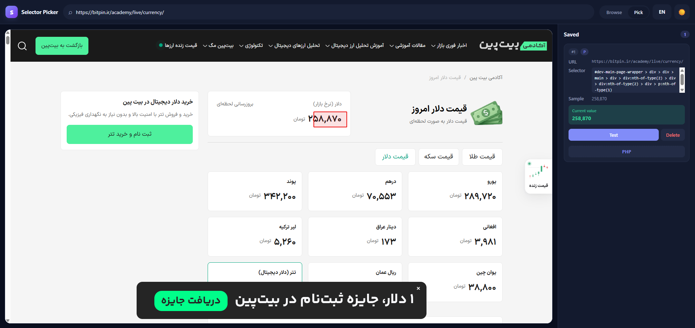

# no-api-needed

> Get any data from any website — no API needed.

A visual element picker that generates a **ready-to-use standalone PHP snippet**
for any element on any page. No Composer, no libraries, no API keys — just
cURL and DOM, which are enabled on virtually every PHP host.

<p align="center">
  
</p>

## ✨ Features

- 🔍 Built-in browser + DuckDuckGo search
- 🖱️ Visual element picker with live highlight
- 📋 Auto-generated standalone PHP snippet (cURL + DOM only)
- 🌐 English / Persian (RTL) UI with saved preference
- 🌗 Light / Dark theme
- 📱 Mobile-friendly responsive layout
- 🚫 Zero external dependencies

## 🚀 Quick Start

```bash
git clone https://github.com/norinsoft/no-api-needed.git
cd no-api-needed
php -S localhost:8000
